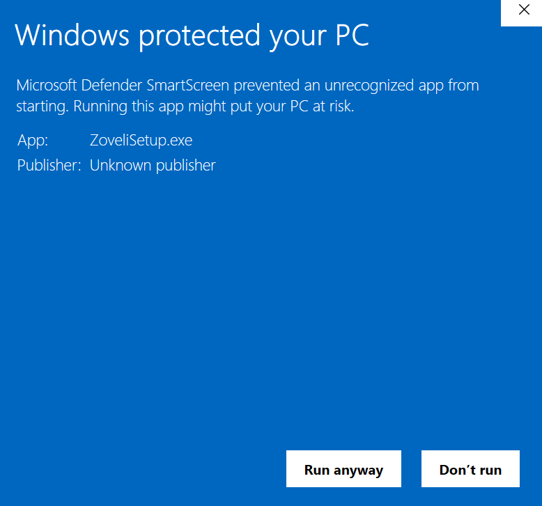
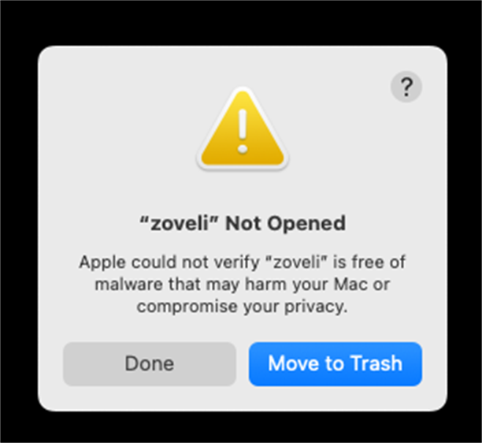

# Sovereign Install Guide

> **Zoveli is independently developed and distributed without paid Apple or
> Microsoft code-signing certificates.** Your operating system will warn you the
> first time you launch it. That warning is expected. This guide turns it into a
> known, one-time step.

Zoveli uses the **Sovereign Distribution** model: the source is open, the builds
run in public CI, and the binaries are unsigned. Integrity comes from published
SHA-256 checksums and GitHub build-provenance attestations, not from a
platform-issued identity. See [Why unsigned?](#why-unsigned) below.

## Before you install

1. Download only from the official
   [GitHub Releases page](https://github.com/blessandy9104-hue/zoveli-ai/releases).
2. Verify the download before bypassing any warning (see
   [Verify before you bypass](#verify-before-you-bypass)).
3. Use a per-user install. Zoveli does not need administrator access for normal
   use.
4. On a managed corporate device, check your IT policy first. SmartScreen,
   AppLocker, WDAC, and Gatekeeper can be enforced centrally, and bypassing them
   may violate policy.

## Linux and macOS (one command)

The primary install is the portable runtime. It needs no Git, Node, Python,
pnpm, or compiler toolchain:

```bash
curl -fsSL https://raw.githubusercontent.com/blessandy9104-hue/zoveli-ai/main/install/install.sh | sh
```

Requirements: Linux `x86_64` or `aarch64` (glibc 2.35+, Ubuntu 22.04 or newer)
or macOS on Apple Silicon or Intel, plus `curl`, `tar`, `bash`, and `sha256sum`
or `shasum`.

The installer:

1. resolves the latest published release (pass `--version` to pin one);
2. downloads the matching `linux-x64`, `linux-arm64`, `macos-arm64`, or
   `macos-x64` archive and verifies its published SHA-256;
3. backs up and verifies an existing vault before an upgrade, then swaps in the
   new runtime with automatic rollback on failure;
4. links `~/.local/bin/zoveli` and prints the `PATH` instructions;
5. runs `zoveli doctor --offline` and reports any blocking problem.

Useful forms:

```bash
# Read-only: installed vs. latest
curl -fsSL .../install.sh | sh -s -- --check

# Non-interactive install
curl -fsSL .../install.sh | sh -s -- --yes

# Append the bin directory to your shell profile (opt-in)
curl -fsSL .../install.sh | sh -s -- --add-to-path

# Install a local, already-verified archive
sh install.sh --archive ./zoveli-0.1.3-linux-x64.tar.gz

# Upgrade by re-running the installer; uninstall keeps ~/.zoveli
sh install.sh --uninstall
sh install.sh --uninstall --purge   # also delete the vault and backups
```

On macOS, `--add-to-path` writes to `~/.zprofile` for zsh, `~/.bash_profile`
for bash, and `~/.profile` for other shells. The one-command path downloads and
extracts a `.tar.gz`, which Gatekeeper does not quarantine, so it does not show
the first-launch dialog; use the `.dmg` section below if you prefer a disk
image.

`zoveli doctor` checks the installed runtime, configuration drift, vault schema,
the mathcore command, and a live MCP handshake. Add `--json` for scripts or
`--offline` to skip the live spawn.

The install directory defaults to `~/.local/share/zoveli`; set `ZOVELI_HOME` or
pass `--dir` to change it. State always stays in `~/.zoveli` until `--purge`.

**Platform status:** tested on the Ubuntu 22.04 x64 and arm64 GitHub runners
and on the macOS arm64 and Intel GitHub runners (install, doctor, idempotent
rerun, uninstall, vault preservation). A true fresh VM or Mac, non-CI arm64
hardware, older macOS releases, and non-Ubuntu distributions are **untested**.
Release `v0.1.3` has no `linux-arm64` archive; arm64 Linux installs work once a
release containing the CI-built archive is published. Release `v0.1.3` also
predates `zoveli doctor`; the installer warns once and continues, and the doctor
check activates with the next published runtime.

The Windows one-command installer is tested on the `windows-latest` x64 runner
(Windows Server 2025) under Windows PowerShell 5.1 and PowerShell 7 with the
child process pinned to **Restricted**, using a path with spaces and a non-ASCII
user profile. Install, doctor, idempotent rerun, PATH opt-in, uninstall, vault
preservation, purge, protected-directory refusal, and Mark-of-the-Web
unblocking are covered. Real Windows 10/11 x64 client hardware, Windows on
ARM64 hardware, older Windows builds, corporate-managed machines, and real
SmartScreen/antivirus blocks remain **untested**. CI attempts a native
`windows-arm64` build on the `windows-11-arm` runner; if that toolchain build
fails, no ARM64 asset is published and the installer stops with a clear message.

## Docker fallback (browser UI)

If the native runtime is not an option, the Docker fallback runs the same
browser UI in a local container. The host needs no Git, Node, Python, pnpm, or
Compose — only Docker:

```bash
curl -fsSL https://raw.githubusercontent.com/blessandy9104-hue/zoveli-ai/main/install/install-docker.sh | sh
# then open http://127.0.0.1:8080
```

Requirements: Docker Engine or Docker Desktop 20.10+ on a `linux/amd64` or
`linux/arm64` container platform. The container is Linux; macOS and Windows
hosts are **untested** even though Docker Desktop can run Linux containers.
Rootless Docker and Podman are also **untested**. Compose is not required.

The installer:

1. pulls `ghcr.io/blessandy9104-hue/zoveli-ai-web` (or uses a local `--image`);
2. starts a container bound to `127.0.0.1` with a health-check wait;
3. stores the vault, sessions, and audit log in the `<name>-data` Docker volume;
4. labels the container so uninstall only removes what it created.

Useful forms:

```bash
# Read-only: container, image, port, volume, and health
curl -fsSL .../install-docker.sh | sh -s -- --check

# Non-interactive install
curl -fsSL .../install-docker.sh | sh -s -- --yes

# Custom host port, container name, or data volume
curl -fsSL .../install-docker.sh | sh -s -- --port 9090 --name zoveli-work

# Upgrade: re-run the installer; a failed upgrade restores the previous container
curl -fsSL .../install-docker.sh | sh -s -- --yes

# Uninstall: the data volume is kept unless --purge is added
curl -fsSL .../install-docker.sh | sh -s -- --uninstall --yes
curl -fsSL .../install-docker.sh | sh -s -- --uninstall --purge --yes
```

Provider keys and runtime settings are read from the current environment (for
example `OPENAI_API_KEY`, `ZOVELI_PROVIDER`, `ZOVELI_MODEL`,
`ZOVELI_API_TOKEN`) and passed to the container without being written to disk
or printed by the installer. Local Ollama is reached through
`host.docker.internal`. Because the UI is bound to loopback, use an SSH tunnel
for remote access rather than exposing the port.

**Docker platform status:** the multi-arch image is built natively for amd64
and arm64 in CI, and the Docker acceptance test covers install, health,
idempotent rerun, upgrade replacement, rollback, volume persistence, and
uninstall/purge on both runners. Until the next release publishes the image,
build it locally with `docker build -t zoveli-web:local .` and pass
`--image zoveli-web:local`. Public anonymous pulls require the GHCR package to
be public; use `docker login ghcr.io` if it is still private.

## Windows 10 and 11

### One-command install (recommended)

The primary Windows install is the portable runtime. It needs Windows 10 version
1809 (build 17763) or later, or Windows 11, on x64 or ARM64; Windows PowerShell
5.1 or PowerShell 7; and the `tar.exe` included with Windows. No administrator
rights, Git, Node, Python, or pnpm are required.

```powershell
irm https://raw.githubusercontent.com/blessandy9104-hue/zoveli-ai/main/install/install.ps1 | iex
```

The installer:

1. resolves the latest published release (`-Version` pins one);
2. checks that the matching `windows-x64` or `windows-arm64` archive and its
   `.sha256` exist before downloading;
3. installs per user under `%LOCALAPPDATA%\Zoveli` and verifies the SHA-256;
4. backs up and verifies the vault before an upgrade, with automatic rollback
   if the new runtime fails its preflight;
5. leaves the user `PATH` unchanged unless `-AddToPath` is passed;
6. runs `zoveli doctor --offline` when the installed runtime provides it.

The vault, configuration, backups, and audit history stay in
`%USERPROFILE%\.zoveli` and survive upgrades and normal uninstalls. Re-running
the same version is a no-op.

Because `irm ... | iex` runs in memory, it works under the default execution
policy, including **Restricted**. You do not need `Set-ExecutionPolicy`. If you
save the script to disk and run it with `-File`, the policy may block it; use
the one-line form instead.

Useful forms:

```powershell
# Read-only status (installed vs. latest)
& ([scriptblock]::Create((irm https://raw.githubusercontent.com/blessandy9104-hue/zoveli-ai/main/install/install.ps1))) -Check

# Opt in to the per-user PATH
& ([scriptblock]::Create((irm https://raw.githubusercontent.com/blessandy9104-hue/zoveli-ai/main/install/install.ps1))) -AddToPath

# Install a specific release, or a local archive you already verified
& ([scriptblock]::Create((irm https://raw.githubusercontent.com/blessandy9104-hue/zoveli-ai/main/install/install.ps1))) -Version 0.1.3
& ([scriptblock]::Create((irm https://raw.githubusercontent.com/blessandy9104-hue/zoveli-ai/main/install/install.ps1))) -Archive .\zoveli-0.1.3-windows-x64.tar.gz -Unblock

# Uninstall: keeps %USERPROFILE%\.zoveli unless -Purge is added
& ([scriptblock]::Create((irm https://raw.githubusercontent.com/blessandy9104-hue/zoveli-ai/main/install/install.ps1))) -Uninstall -Yes
& ([scriptblock]::Create((irm https://raw.githubusercontent.com/blessandy9104-hue/zoveli-ai/main/install/install.ps1))) -Uninstall -Purge -Yes
```

`-Force` is required to downgrade or to reinstall the same version. `-Unblock`
removes Mark-of-the-Web from an archive downloaded through a browser (and from
the installed executables) so SmartScreen or antivirus heuristics are less
likely to block the bundled `node.exe`. `-Archive` also accepts a renamed copy
you verified yourself: the version and architecture are read from the archive's
`runtime.json` after the checksum passes.

### Windows on ARM64

Windows 11 on ARM64 is supported when the release publishes a native
`windows-arm64` archive. The installer checks the release assets first and uses
the native build. If the release has no `windows-arm64` asset, it stops with a
clear message; it does **not** silently install the x64 archive under emulation.
To accept emulation deliberately, pass the x64 `-Archive` together with
`-Force`.

CI builds and attaches the native `windows-arm64` archive and its checksum, but
that build leg is still non-blocking and no real ARM64 client hardware has run
this installer yet. The unsigned `.exe` installer remains x64-only and is not
produced on ARM64.

### SmartScreen, antivirus, and Mark-of-the-Web

Official Windows binaries are unsigned. SmartScreen and antivirus products may
warn about or block `node.exe` or the bundled `mathcore-mcp.exe` on first use.
The installer reports Mark-of-the-Web on a supplied archive and warns if
`mathcore-mcp.exe` is missing after extraction, which usually means antivirus
quarantined it.

1. Open **Windows Security > Protection history** and check for a blocked or
   quarantined Zoveli file.
2. If you trust the release (verify the SHA-256 and, optionally, the build
   provenance attestation), choose **Allow** or **Restore** for that file.
3. For a browser-downloaded archive, open its **Properties**, tick
   **Unblock**, then retry. Or pass `-Unblock`.
4. Retry the installer.

Do not disable SmartScreen, Defender, AppLocker, or WDAC. On a managed device,
ask IT first; central policy may prohibit the install entirely.

> **No "Run anyway" button?** The device is probably managed by SmartScreen,
> AppLocker, or WDAC policy. Use the one-command install above, which executes
> in memory and does not require launching the unsigned `.exe` installer. If
> policy still blocks the bundled executables, ask your IT administrator.

### Unsigned `.exe` installer (alternative)

The Windows `.exe` is `zoveli-0.1.3-windows-x64-setup.exe` (the version changes
with each release). It is x64-only and installs the same runtime per user.

1. Download the `.exe` from the official Releases page.
2. Double-click the installer.
3. If **Windows protected your PC** appears, click **More info**.
4. Confirm the app is **Zoveli** and the publisher is **Unknown publisher**.
   That is expected for an unsigned build.
5. Click **Run anyway**.
6. Finish the installer. Zoveli installs per user under
   `%LOCALAPPDATA%\Zoveli`; no administrator prompt is required.
7. Launch Zoveli from the Start menu or run `zoveli.cmd` from the install
   directory.



To move from the `.exe` to the one-command installer, uninstall Zoveli from
**Settings > Apps** first. The one-command installer refuses to overwrite an
existing `.exe` installation so the two upgrade paths cannot corrupt each
other. The vault is preserved.

## macOS (Gatekeeper)

The disk image is an alternative to the one-command install above. The official
macOS installers are:

- `zoveli-0.1.3-macos-arm64-setup.dmg` for Apple Silicon (M-series) Macs.
- `zoveli-0.1.3-macos-x64-setup.dmg` for Intel Macs.

The disk image contains the portable `zoveli-<version>-macos-<arch>` runtime. It
is not a `.app` bundle, so Gatekeeper assesses the `zoveli` launcher itself
rather than an app bundle.

1. Download the `.dmg` that matches your Mac from the official Releases page.
2. Double-click the disk image, then copy the `zoveli-<version>-macos-<arch>`
   folder to a location you control, such as `~/Applications`.
3. Open the copied folder in Finder and double-click `zoveli`. The first launch
   shows **“zoveli” Not Opened** with **Done** and **Move to Trash**. Click
   **Done**; do not move the runtime to the trash.
4. Open **System Settings → Privacy & Security**, scroll to the **Security**
   section, and click **Open Anyway** next to the blocked `zoveli` item.
   Authenticate, then click **Open** in the confirmation dialog.
5. Run `zoveli` again from Finder, or from Terminal. Use the folder that
   matches your Mac:

   ```bash
   ~/Applications/zoveli-0.1.3-macos-arm64/zoveli   # Apple Silicon
   ~/Applications/zoveli-0.1.3-macos-x64/zoveli    # Intel
   ```

6. If macOS still blocks the executable, verify the download first, then remove
   the quarantine flag from the folder you copied. The example below is for
   Apple Silicon; use `macos-x64` on Intel:

   ```bash
   xattr -dr com.apple.quarantine ~/Applications/zoveli-0.1.3-macos-arm64
   ~/Applications/zoveli-0.1.3-macos-arm64/zoveli
   ```

7. Never disable Gatekeeper globally. Use **Open Anyway** or the quarantine
   command only for a download you have verified.



## Verify before you bypass

Unsigned does not mean unverified. Compare the downloaded archive with its
published SHA-256 sidecar, and check the build-provenance attestation.

**macOS or Linux:**

```bash
# Use macos-x64 instead of macos-arm64 on an Intel Mac.
shasum -a 256 zoveli-0.1.3-macos-arm64.tar.gz
cat zoveli-0.1.3-macos-arm64.tar.gz.sha256
```

**Windows PowerShell:**

```powershell
Get-FileHash .\zoveli-0.1.3-windows-x64.tar.gz -Algorithm SHA256
Get-Content .\zoveli-0.1.3-windows-x64.tar.gz.sha256
```

**Build provenance (optional, requires GitHub CLI):**

```bash
gh attestation verify zoveli-0.1.3-windows-x64-setup.exe \
  --repo blessandy9104-hue/zoveli-ai \
  --signer-workflow blessandy9104-hue/zoveli-ai/.github/workflows/runtime-artifacts.yml
```

The `.dmg` and `.exe` are built by the same public
`Runtime Artifacts` workflow and carry provenance attestations. The portable
`.tar.gz` archives also publish `.sha256` sidecars.

## Why unsigned?

Zoveli is a solo, independent open-source project. Paid Apple Developer Program
and Microsoft Authenticode certificates impose recurring fees, identity
requirements, and corporate gatekeepers on the release process. The Sovereign
Distribution model makes a different trade-off:

- **Independence:** no certificate authority can revoke the project's ability to
  ship, and no platform fee is passed to users.
- **Transparency:** the source is MIT licensed and every official build runs in
  public GitHub Actions.
- **Integrity without identity:** checksums and build-provenance attestations
  prove what was built and where. They do not prove a corporate identity, so the
  operating system asks you to make the final trust decision.

That first-launch warning is the visible cost of keeping Zoveli free and
independent. The steps above make it predictable.

## Troubleshooting

| Symptom | What to do |
| --- | --- |
| Windows shows "Windows protected your PC" | Click **More info**, then **Run anyway**. |
| Windows has no **Run anyway** button | The device is policy-managed. Use the portable `.tar.gz` or contact IT. |
| macOS shows **“zoveli” Not Opened** (Apple could not verify it) | Click **Done**, then **System Settings → Privacy & Security → Open Anyway**, authenticate, and click **Open**. |
| macOS blocks the disk image or says it cannot be verified | Open **System Settings → Privacy & Security → Open Anyway** for the disk image. |
| macOS still blocks the `zoveli` executable after you approve it | Verify the checksum, then remove the quarantine flag from the copied runtime folder. |
| macOS blocks the runtime after an update | Repeat the first-launch **Open Anyway** or `xattr` step for the new version. |
| You are unsure whether a download is genuine | Delete it and download again from the official Releases page; verify the checksum and attestation. |

## Screenshots

The Windows image is a real Windows 11 SmartScreen capture from the unsigned
`zoveli-0.1.3-windows-x64-setup.exe`. The macOS image is a real macOS 15
Sequoia Gatekeeper capture from the unsigned portable `zoveli` launcher. Both
are refreshed when the installers or the operating-system dialogs change.

- `docs/assets/windows-smartscreen.png`
- `docs/assets/macos-gatekeeper.png`

_Last reviewed: 2026-11-13._
