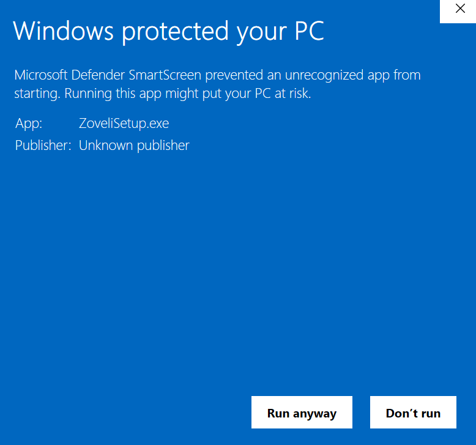
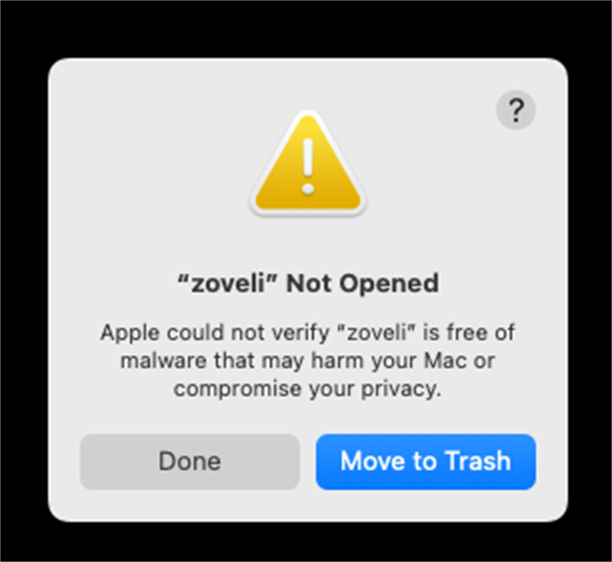

# Sovereign Install Guide

> **Zoveli is independently developed and distributed without paid Apple or
> Microsoft code-signing certificates.** Your operating system will warn you the
> first time you launch it. That warning is expected. This guide turns it into a
> known, one-time step.

Zoveli uses the **Sovereign Distribution** model: the source is open, the builds
run in public CI, and the binaries are unsigned. Integrity comes from published
SHA-256 checksums and GitHub build-provenance attestations, not from a
platform-issued identity. See [Why unsigned?](#why-unsigned) below.

## Before you install

1. Download only from the official
   [GitHub Releases page](https://github.com/blessandy9104-hue/zoveli-ai/releases).
2. Verify the download before bypassing any warning (see
   [Verify before you bypass](#verify-before-you-bypass)).
3. Use a per-user install. Zoveli does not need administrator access for normal
   use.
4. On a managed corporate device, check your IT policy first. SmartScreen,
   AppLocker, WDAC, and Gatekeeper can be enforced centrally, and bypassing them
   may violate policy.

## Linux (one command)

The primary Linux install is the portable runtime. It needs no Git, Node,
Python, pnpm, or compiler toolchain:

```bash
curl -fsSL https://raw.githubusercontent.com/blessandy9104-hue/zoveli-ai/main/install/install.sh | sh
```

Requirements: Linux `x86_64` or `aarch64`, glibc 2.35+ (Ubuntu 22.04 or newer),
`curl`, `tar`, `bash`, and `sha256sum` or `shasum`.

The installer:

1. resolves the latest published release (pass `--version` to pin one);
2. downloads the matching `linux-x64` or `linux-arm64` archive and verifies its
   published SHA-256;
3. backs up and verifies an existing vault before an upgrade, then swaps in the
   new runtime with automatic rollback on failure;
4. links `~/.local/bin/zoveli` and prints the `PATH` instructions;
5. runs `zoveli doctor --offline` and reports any blocking problem.

Useful forms:

```bash
# Read-only: installed vs. latest
curl -fsSL .../install.sh | sh -s -- --check

# Non-interactive install
curl -fsSL .../install.sh | sh -s -- --yes

# Append the bin directory to ~/.profile (opt-in)
curl -fsSL .../install.sh | sh -s -- --add-to-path

# Install a local, already-verified archive
sh install.sh --archive ./zoveli-0.1.3-linux-x64.tar.gz

# Upgrade by re-running the installer; uninstall keeps ~/.zoveli
sh install.sh --uninstall
sh install.sh --uninstall --purge   # also delete the vault and backups
```

`zoveli doctor` checks the installed runtime, configuration drift, vault schema,
the mathcore command, and a live MCP handshake. Add `--json` for scripts or
`--offline` to skip the live spawn.

The install directory defaults to `~/.local/share/zoveli`; set `ZOVELI_HOME` or
pass `--dir` to change it. State always stays in `~/.zoveli` until `--purge`.

**Platform status:** tested on the Ubuntu 22.04 x64 GitHub runner (install,
doctor, idempotent rerun, uninstall, vault preservation) and built for Ubuntu
22.04 arm64 in CI. A true fresh VM, arm64 hardware, and non-Ubuntu distributions
are **untested**. Release `v0.1.3` has no `linux-arm64` archive; arm64 installs
work once a release containing the CI-built archive is published. Release
`v0.1.3` also predates `zoveli doctor`; the installer warns once and continues,
and the doctor check activates with the next published runtime.

## Windows 10 and 11 (SmartScreen)

The Windows installer is
`zoveli-0.1.3-windows-x64-setup.exe` (the version changes with each release).

1. Download the `.exe` from the official Releases page.
2. Double-click the installer.
3. If **Windows protected your PC** appears, click **More info**.
4. Confirm the app is **Zoveli** and the publisher is **Unknown publisher**.
   That is expected for an unsigned build.
5. Click **Run anyway**.
6. Finish the installer. Zoveli installs per user under
   `%LOCALAPPDATA%\Zoveli`; no administrator prompt is required.
7. Launch Zoveli from the Start menu or run `zoveli.cmd` from the install
   directory.



> **No "Run anyway" button?** The device is probably managed by SmartScreen,
> AppLocker, or WDAC policy. Use the portable `.tar.gz` archive instead: extract
> it and run `zoveli.cmd`, or ask your IT administrator.

## macOS (Gatekeeper)

The official macOS installers are:

- `zoveli-0.1.3-macos-arm64-setup.dmg` for Apple Silicon (M-series) Macs.
- `zoveli-0.1.3-macos-x64-setup.dmg` for Intel Macs.

The disk image contains the portable `zoveli-<version>-macos-<arch>` runtime. It
is not a `.app` bundle, so Gatekeeper assesses the `zoveli` launcher itself
rather than an app bundle.

1. Download the `.dmg` that matches your Mac from the official Releases page.
2. Double-click the disk image, then copy the `zoveli-<version>-macos-<arch>`
   folder to a location you control, such as `~/Applications`.
3. Open the copied folder in Finder and double-click `zoveli`. The first launch
   shows **“zoveli” Not Opened** with **Done** and **Move to Trash**. Click
   **Done**; do not move the runtime to the trash.
4. Open **System Settings → Privacy & Security**, scroll to the **Security**
   section, and click **Open Anyway** next to the blocked `zoveli` item.
   Authenticate, then click **Open** in the confirmation dialog.
5. Run `zoveli` again from Finder, or from Terminal. Use the folder that
   matches your Mac:

   ```bash
   ~/Applications/zoveli-0.1.3-macos-arm64/zoveli   # Apple Silicon
   ~/Applications/zoveli-0.1.3-macos-x64/zoveli    # Intel
   ```

6. If macOS still blocks the executable, verify the download first, then remove
   the quarantine flag from the folder you copied. The example below is for
   Apple Silicon; use `macos-x64` on Intel:

   ```bash
   xattr -dr com.apple.quarantine ~/Applications/zoveli-0.1.3-macos-arm64
   ~/Applications/zoveli-0.1.3-macos-arm64/zoveli
   ```

7. Never disable Gatekeeper globally. Use **Open Anyway** or the quarantine
   command only for a download you have verified.



## Verify before you bypass

Unsigned does not mean unverified. Compare the downloaded archive with its
published SHA-256 sidecar, and check the build-provenance attestation.

**macOS or Linux:**

```bash
# Use macos-x64 instead of macos-arm64 on an Intel Mac.
shasum -a 256 zoveli-0.1.3-macos-arm64.tar.gz
cat zoveli-0.1.3-macos-arm64.tar.gz.sha256
```

**Windows PowerShell:**

```powershell
Get-FileHash .\zoveli-0.1.3-windows-x64.tar.gz -Algorithm SHA256
Get-Content .\zoveli-0.1.3-windows-x64.tar.gz.sha256
```

**Build provenance (optional, requires GitHub CLI):**

```bash
gh attestation verify zoveli-0.1.3-windows-x64-setup.exe \
  --repo blessandy9104-hue/zoveli-ai \
  --signer-workflow blessandy9104-hue/zoveli-ai/.github/workflows/runtime-artifacts.yml
```

The `.dmg` and `.exe` are built by the same public
`Runtime Artifacts` workflow and carry provenance attestations. The portable
`.tar.gz` archives also publish `.sha256` sidecars.

## Why unsigned?

Zoveli is a solo, independent open-source project. Paid Apple Developer Program
and Microsoft Authenticode certificates impose recurring fees, identity
requirements, and corporate gatekeepers on the release process. The Sovereign
Distribution model makes a different trade-off:

- **Independence:** no certificate authority can revoke the project's ability to
  ship, and no platform fee is passed to users.
- **Transparency:** the source is MIT licensed and every official build runs in
  public GitHub Actions.
- **Integrity without identity:** checksums and build-provenance attestations
  prove what was built and where. They do not prove a corporate identity, so the
  operating system asks you to make the final trust decision.

That first-launch warning is the visible cost of keeping Zoveli free and
independent. The steps above make it predictable.

## Troubleshooting

| Symptom | What to do |
| --- | --- |
| Windows shows "Windows protected your PC" | Click **More info**, then **Run anyway**. |
| Windows has no **Run anyway** button | The device is policy-managed. Use the portable `.tar.gz` or contact IT. |
| macOS shows **“zoveli” Not Opened** (Apple could not verify it) | Click **Done**, then **System Settings → Privacy & Security → Open Anyway**, authenticate, and click **Open**. |
| macOS blocks the disk image or says it cannot be verified | Open **System Settings → Privacy & Security → Open Anyway** for the disk image. |
| macOS still blocks the `zoveli` executable after you approve it | Verify the checksum, then remove the quarantine flag from the copied runtime folder. |
| macOS blocks the runtime after an update | Repeat the first-launch **Open Anyway** or `xattr` step for the new version. |
| You are unsure whether a download is genuine | Delete it and download again from the official Releases page; verify the checksum and attestation. |

## Screenshots

The Windows image is a real Windows 11 SmartScreen capture from the unsigned
`zoveli-0.1.3-windows-x64-setup.exe`. The macOS image is a real macOS 15
Sequoia Gatekeeper capture from the unsigned portable `zoveli` launcher. Both
are refreshed when the installers or the operating-system dialogs change.

- `docs/assets/windows-smartscreen.png`
- `docs/assets/macos-gatekeeper.png`

_Last reviewed: 2026-11-06._
